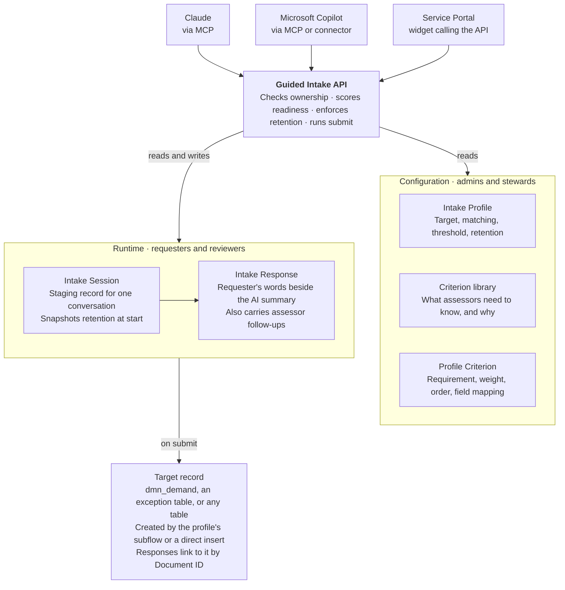

# Guided Intake — Administration, Configuration, and Use

Nov 7, 2026 · Jake

## Overview

Guided Intake replaces static intake forms with an AI-coached interview that gathers what assessors actually need, then creates the target record. It runs as the scoped app **Guided Intake** (`x_312586_gintake`) and serves any process that starts with "someone asks for something that must be assessed": security exceptions, SPM demands, complex catalog requests, architecture reviews.

A static form asks everyone the same questions. What an assessor needs changes per process, per team, and per request, so forms either sprawl into dozens of bespoke fields or stay generic and produce thin requests. Guided Intake keeps a small fixed core and lets the questioning adapt.

### How the pieces fit

| Component | What it is | Who owns it |
| --- | --- | --- |
| Intake Profile | One per intake type. Names the target table, matching rules, submit behavior, readiness threshold, and transcript retention | App admin, with the profile's owner group |
| Criterion library | Shared definitions of what assessors need to know and why. Describes intent, never a fixed question | Criteria stewards |
| Profile Criterion | Attaches a library criterion to a profile with a requirement level, weight, order, and optional field mapping | Criteria stewards |
| Intake Session | One coaching conversation. Acts as the staging record; nothing touches the target table until submit | The requester |
| Intake Response | One answer per criterion, plus ad-hoc and assessor follow-up questions. Keeps the requester's words and the AI summary separate | The requester; reviewers raise follow-ups |
| Guided Intake API | Scripted REST API at `/api/x_312586_gintake/v1/intake` that every front end uses | App admin |
| Agent front end | Claude, Microsoft Copilot, or a portal widget that conducts the interview by calling the API | Platform team |

The division of labor is deliberate. The AI decides how to ask, when to probe, and whether an answer meets a criterion's intent. The platform decides the readiness score, maps answers into the target record, and enforces access and retention. Because all logic sits behind the API, the front end can change without rework.



Front ends never write tables directly. They call the API as the requester. The API reads configuration, keeps all session state in the app, and only creates the target record at submit.

## Roles and access

Requesters need no app role: any internal user (`snc_internal`) can start sessions and work on their own. Three app roles cover everyone else.

| Role | Grant to | Can do |
| --- | --- | --- |
| `x_312586_gintake.admin` | Platform owners of Guided Intake | Everything: create and edit profiles, set retention, edit any session or response, delete records. Contains the two roles below |
| `x_312586_gintake.criteria_steward` | The library governance owner(s) | Create and edit criteria and profile criteria. Cannot edit profiles or delete criteria |
| `x_312586_gintake.reviewer` | Assessors in consuming processes (InfoSec, portfolio managers) | Read all sessions and responses; raise follow-up questions; edit their own follow-up while it is open |

### What requesters can do

- Read active profiles and criteria (the agent needs them to run the interview).
- Create sessions, and read and edit their own sessions while they are in progress.
- Add and edit responses on their own in-progress sessions.
- Answer open follow-ups on their own sessions at any time, including after submit.

### Protected fields

These session and response fields are admin-write only at the field ACL level, so no one can bypass the submit and scoring logic through the Table API or a list edit:

- Session: `state`, `readiness_score`, `target_table`, `target_record`, `submitted_on`, `transcript_retention`, `transcript_purge_on`
- Response: `target_table`, `target_record`

The Guided Intake API writes these fields server-side after checking ownership itself. Non-owners asking for a session they cannot see get a 404, so the API does not reveal which session IDs exist.

### Granting access

1. Add assessors to a group and grant that group `x_312586_gintake.reviewer`.
2. Name one or two criteria stewards per organization, not per team. The library only stays reusable if few people curate it.
3. Keep `admin` to the platform team. Profile owners request changes through it until per-group profile editing is added (see Administration and operations).

## Configuring an intake profile

A new intake type needs one profile, a set of profile criteria, and optionally a submit subflow; no code or schema changes. Profiles live at `x_312586_gintake_profile_list.do`.

### Steps

1. **Confirm the target table.** Note its mandatory fields and data policies; the submitted record must satisfy them.
2. **Create the profile** (fields below). Leave it inactive while you build it.
3. **Attach criteria** from the library on the Profile Criteria related list, setting requirement, weight, order, and any field mapping. Ask a steward to add missing criteria to the library rather than creating near-duplicates.
4. **Decide how submit works.** Leave Submit subflow empty for a direct insert, or build a subflow (see Building a submit subflow).
5. **Test as a non-admin requester** through the API or agent: start a session, answer a few criteria, check readiness, submit.
6. **Activate the profile.**

### Profile fields

| Field | Purpose | Guidance |
| --- | --- | --- |
| Name | Shown to requesters and the agent | Name it the way requesters describe the request: "Security exception", not "InfoSec RA-2 intake" |
| Active | Only active profiles are listed, matched, or startable | Deactivate instead of deleting; existing sessions keep working |
| Description | Helps the agent pick the right profile from a requester's intent | One or two plain sentences on when to use it |
| Owner group | Accountable for the profile and its criteria | Use the assessing team's group |
| Target table | Table the submit creates a record in | Any table, e.g. `dmn_demand` or your exception table |
| Applies to | Optional condition on the target table for sub-profiles | Example: Demand category is Strategic |
| Order | Precedence when more than one profile matches | Lowest wins; give the catch-all profile the highest number |
| Submit subflow | Subflow that creates or updates the target record | Empty means a direct insert with the requester's own permissions |
| Ready threshold | Readiness score (0–100) at which submitting is encouraged | Default 80; see Readiness scoring |
| Agent guidance | Profile-level context and tone for the coaching agent | Audience, vocabulary to use or avoid, sensitivities. Example: "Requesters are business users; avoid security jargon; never ask for credentials or secrets" |
| Transcript retention | What is kept from the conversation | See the retention table below |
| Transcript retention (days) | Days after submit before a full transcript is purged | 0 keeps it indefinitely; ignored unless retention is Full |

### How profile matching works

Agents can pick a profile from the list (`GET /profiles`) or ask the API to match one (`GET /profiles/match`). Matching takes the target table and a JSON context of field values, applies them to an unsaved record of that table, and tests each active profile's Applies to condition with the platform's own filter engine. The lowest-order match wins, and a profile with no condition matches everything for its table. Context fields that do not exist on the table are ignored and listed in the response.

### Transcript retention

| Setting | Responses | Summary | Full transcript |
| --- | --- | --- | --- |
| None — responses only | Kept | Never stored | Never stored |
| Summary only (default) | Kept | Kept | Never stored |
| Full transcript (attachment) | Kept | Kept | Kept until the purge date |

Retention is enforced when data is written, not cleaned up later: the API refuses to store what the policy excludes. Each session copies the profile's setting when it starts, so changing a profile affects new sessions only. Choose None for sensitive domains where the conversation itself should not persist, and Full where an audit trail of how the request was formed matters, such as risk acceptance.

## Managing the criteria library

A criterion describes what assessors need to learn and why, never the exact question; the agent phrases the question for each conversation. The library (`x_312586_gintake_criterion_list.do`) is shared across every profile, which is what keeps one change from becoming five.

### Criterion fields

| Field | Purpose |
| --- | --- |
| Name | Unique, short, reusable: "Business sponsor", "Impact if not done" |
| Category | Groups the library: business value, risk, cost and effort, ownership, timing, compliance, technical. You can type a new value |
| Question intent | What we need to know, in one or two sentences |
| Why it matters | Shared with the requester so they understand what is being weighed. This is often what turns a vague answer into a useful one |
| Coaching hints | Follow-up probes and common gaps the agent should watch for |
| Good answer example | What a sufficient answer looks like; the agent uses it to judge completeness |
| Answer type | Text, Number, Date, Yes/No, Choice, or Reference; drives validation of the normalized answer |
| Answer options | Choice: one `value\|label` per line. Reference: the referenced table name |

### Writing a good criterion

|  | Weak | Strong |
| --- | --- | --- |
| Name | "Q7 – Justification" | "Impact if not done" |
| Question intent | "Why do you need this?" | "What happens to the business, customers, or compliance if this request is declined or delayed by a quarter?" |
| Why it matters | (empty) | "Assessors compare the cost of doing this against the cost of not doing it. Without a concrete consequence, requests default to low priority." |
| Coaching hints | (empty) | "Push past 'it would be better'. Ask for a number, a date, a named customer, or a regulation. If they don't know, mark it Unknown rather than guessing." |
| Good answer example | (empty) | "Without it, the Q3 audit finds the gap (control AC-2), and we risk a qualified opinion; roughly 40 hours of manual evidence gathering per quarter." |

Keep a criterion process-neutral. Put anything specific to one process in the Profile Criterion's guidance instead.

### Profile criteria

Attach criteria to a profile on its Profile Criteria related list. Each criterion appears once per profile.

| Field | Purpose | Guidance |
| --- | --- | --- |
| Requirement | Must have, Should have, Nice to have | A must-have that is still open blocks the ready state. Use it sparingly; three to five per profile |
| Weight | 1–10 multiplier within the requirement level | Leave at 1 until assessors tell you some answers matter more |
| Order | Interview order | The agent follows it loosely and adapts to the conversation |
| Maps to field | Optional target-table column filled on submit | Use for core fields only (sponsor, dates, category). Leave the rest in responses |
| Profile-specific guidance | Extra coaching for this criterion in this profile only | Keeps the library wording shared |

### Field mapping on submit

For each mapped criterion, submit takes the most recent answered or partial response and uses its normalized answer value. Text criteria fall back to the AI summary, then the requester's own words. A mapping to a column that does not exist is skipped and logged as a warning rather than failing the requester's submit.

### Stewardship

- **Search before adding.** A near-duplicate ("Executive sponsor" beside "Business sponsor") splits reporting and doubles maintenance.
- **Retire, don't delete.** Deactivating a criterion removes it from profiles immediately; deletion is admin-only and blocked while any profile or response references it.
- **Edits are live everywhere.** A wording change affects every profile using the criterion. Past responses keep the question as it was actually asked, so history stays accurate.
- **Review quarterly with assessors.** Ask which follow-up questions they keep raising; recurring follow-ups are missing criteria or weak coaching hints.

## Building a submit subflow

Use a subflow when submit must do more than insert one record: set fields from the summary, route to an assignment group, open an approval, or update an existing record. Without one, the API inserts the mapped field values into the target table using the requester's own create permissions, so intake can never create a record the requester could not create directly.

### Contract

The API calls the subflow in the foreground with a 60-second timeout. All inputs are strings.

| Direction | Name | Required | Content |
| --- | --- | --- | --- |
| Input | `session_sys_id` | Yes | The intake session; use it for idempotency |
| Input | `requester` | Yes | sys_user sys_id of the requester |
| Input | `summary` | Yes | AI summary; empty when retention is None |
| Input | `field_values` | Yes | JSON object of target column to value, from the profile's field mappings |
| Input | `readiness_score` | Yes | 0–100 |
| Output | `target_sys_id` | Yes | sys_id of the record created or updated |
| Output | `target_table` | No | Table of that record; defaults to the profile's target table |

### Build steps

1. In Flow Designer, create a subflow with the five inputs and two outputs above, using those exact names.
2. Parse `field_values` with a JSON parser step or a script step, then create or update the target record.
3. Write the summary wherever assessors read it, typically the description or a work note.
4. Set `target_sys_id` (and `target_table` if different) as outputs. A missing or invalid sys_id fails the submit.
5. Publish the subflow and select it in the profile's Submit subflow field. Only active subflows appear in the picker.

### Idempotency and failures

If the subflow throws an error or returns no valid record, the session stays in progress and the requester can retry. If the subflow commits but something fails afterward, a retry calls it again. Guard against duplicates by looking up a record already linked to `session_sys_id` before creating one, for example through a correlation field on the target table.

### Run-as

The subflow's own Run As setting applies. Running as the user who initiates it preserves the requester's permissions, which matches the default insert. Running as System is appropriate when requesters legitimately cannot create the target record themselves, but then the subflow is the only access control; validate inputs accordingly.

## Readiness scoring

A session is **ready** when no must-have criterion is open and its score meets the profile's threshold. The score is plain arithmetic on response statuses, so every number can be explained line by line; the AI only decides each response's status.

```
score  = round(100 × Σ(points × credit) / Σ points)
points = requirement multiplier × weight
```

| Requirement | Multiplier |
| --- | --- |
| Must have | 3 |
| Should have | 2 |
| Nice to have | 1 |

| Response status | Credit |
| --- | --- |
| Answered | 1 |
| Not applicable | 1 |
| Partially answered | 0.5 |
| Unknown, requested, not asked | 0 |

Where a criterion has several responses, the best status counts, and open follow-ups are ignored. A profile with no active criteria scores 100.

### Worked example

A profile has one must-have (weight 1) answered partially and one should-have (weight 5) answered. Points are 3 and 10, credit earned is 1.5 + 10 = 11.5 of 13, so the score is 88. It is still **not ready**, because the must-have is only partial.

### Flags

Readiness also returns flags for assessors: a must-have marked Not applicable (it earns credit but deserves a challenge), and any criterion where the requester said they don't know. "Unknown" is treated as an honest gap, not a failure, and the agent is coached to record it rather than guess.

### Readiness is an indicator, not a gate

A requester can always submit. If the session is not ready, the API returns `409 not_ready` with the gaps; the agent must show them and get explicit agreement, then resubmit with `acknowledge_gaps: true`. The submit response reports that gaps were acknowledged, and the session keeps the score it was submitted at.

### Tuning

- **Start at threshold 80 with all weights at 1.** Adjust only after watching real sessions.
- **Too many submits with gaps acknowledged:** criteria may be marked must-have that aren't, or coaching hints are not drawing out answers.
- **Assessors still bouncing requests back:** the missing information is probably not a criterion yet. Add it, or raise its requirement.
- **Requesters abandoning sessions:** the profile asks too much. Cut nice-to-haves before lowering the threshold.

## Using Guided Intake

Requesters have a conversation; assessors get a structured record with the requester's own words beside a clean summary. Neither needs to learn a new form.

### For requesters

1. **Start from the assistant** (Claude, Copilot, or the portal) and describe what you need in your own words. The assistant picks the matching intake type and confirms it with you.
2. **Answer the questions it asks.** It explains why each one matters and gives examples of a useful answer. You can answer in any order, come back to earlier answers, or say you don't know; "I don't know" is recorded honestly rather than guessed.
3. **Watch your readiness.** The assistant tells you which must-have answers are still open and roughly how complete the request is.
4. **Pause any time.** Your session is saved; ask the assistant to continue your open request later.
5. **Submit.** If anything is still missing, the assistant lists it and asks whether to submit anyway. You get a link to the created record.
6. **Answer follow-ups.** If an assessor needs more, ask the assistant "do I have any follow-up questions?" Answers go straight to the assessor, even after submitting.

You can also abandon a request you no longer need; it is closed and any transcript is removed.

### What gets kept

Your answers are always kept with the request. Whether the assistant's summary and the full conversation are kept depends on the intake type's retention setting, which the assistant can tell you. Your exact words are stored separately from the assistant's summary, so assessors always see what you actually said.

### For assessors (reviewer role)

1. **Open the target record** (the demand, exception, or request). Its responses are linked to it through Target record, each showing the question asked, the requester's verbatim answer, the AI summary, and a status. Until a related list is configured for that table (see Administration and operations), filter `x_312586_gintake_response_list.do` by Target record.
2. **Read status before content.** Partial and Unknown answers, and must-haves marked Not applicable, are the places to probe.
3. **Raise a follow-up instead of emailing.** Open the session (`x_312586_gintake_session_list.do`) and add a follow-up through the API or your assistant. It lands as a Requested response and fires the event `x_312586_gintake.followup.raised`.
4. **Edit your follow-up** while it is still open; once the requester answers, it becomes part of the record. Only an admin can delete one.

All sessions and responses are readable by reviewers, including in-progress ones, which helps when a requester asks for advice mid-interview.

## API reference for agent builders

Every front end talks to one Scripted REST API at `/api/x_312586_gintake/v1/intake`, authenticated as the requester (per-user OAuth) so ownership and permissions follow the person. Any internal user may call it; handlers check session ownership on every call.

Success returns `{ "result": … }`. Failure returns `{ "error": { "code", "message", "details" } }`.

### Endpoints

| Method | Path | Purpose |
| --- | --- | --- |
| GET | `/profiles?target_table=` | Active profiles for choosing from the requester's intent |
| GET | `/profiles/match?target_table=&context={json}` | Lowest-order profile whose condition matches the context |
| GET | `/profiles/{id}` | Profile bundle: guidance, threshold, retention, ordered criteria |
| GET | `/sessions?state=` | The caller's sessions, newest first (resume) |
| POST | `/sessions` | Start: `{ profile_id, channel }` returns session, profile bundle, readiness |
| GET | `/sessions/{id}` | Session, profile bundle, all responses, readiness |
| PATCH | `/sessions/{id}` | `{ summary }`; not stored when retention is None |
| PUT | `/sessions/{id}/responses` | Batch upsert, up to 50; returns `{ written, errors, readiness }` |
| GET | `/sessions/{id}/readiness` | Score, threshold, ready, gaps, flags, breakdown |
| POST | `/sessions/{id}/transcript` | `{ transcript }`; stored only when retention is Full; replaces any earlier copy |
| POST | `/sessions/{id}/submit` | `{ acknowledge_gaps? }`; returns the target record and its URL |
| POST | `/sessions/{id}/abandon` | Close without submitting |
| GET | `/followups` | Open follow-ups across the caller's sessions |
| POST | `/sessions/{id}/followups` | Reviewers: `{ question, criterion_id? }` |

`channel` is one of `claude`, `copilot`, `portal`, `other`.

### Typical call sequence

1. `GET /sessions?state=in_progress` to offer resuming, and `GET /followups` to surface open questions first.
2. `GET /profiles` (or `/profiles/match`) and confirm the choice with the requester.
3. `POST /sessions`. Keep the returned profile bundle in context; it is everything needed to coach.
4. Interview. After each answer or small batch, `PUT /sessions/{id}/responses`. The returned readiness lists gaps in must → should → nice order, which tells the agent what to ask next.
5. Before submit, `PATCH` the summary and, under Full retention, `POST` the transcript.
6. `POST /submit`. On `409 not_ready`, show the gaps, get agreement, and resubmit with `acknowledge_gaps: true`.

### Writing responses

Each item in `responses` is matched in this order:

1. `response_id` updates that response. This is how follow-ups are answered, including after submit.
2. `criterion_id` updates the agent-asked response for that criterion, or creates it.
3. Neither creates an ad-hoc response; `question_asked` is required.

| Field | Notes |
| --- | --- |
| `question_asked` | Required on create; a snapshot that is never rewritten |
| `requester_verbatim` | The requester's own words. Never paraphrase into this field |
| `ai_summary` | The agent's clean version |
| `answer_value` | Normalized value for typed criteria: number, `yyyy-MM-dd`, `true`/`false`, a choice value, or an existing sys_id. Validated when status is answered or partial |
| `status` | `answered`, `partial`, `unknown`, or `not_applicable`. Agents cannot set `requested` |

Items are processed independently: one bad item returns in `errors` with its index while the rest are written. The call returns 400 only when nothing was written.

### Error codes

| HTTP | Code | Meaning |
| --- | --- | --- |
| 400 | `bad_request` | Missing or invalid input, including answer-type validation |
| 403 | `forbidden` | Reviewer writing a session they don't own; non-reviewer raising a follow-up; no create permission on the target table |
| 404 | `not_found` | Unknown id, or a session the caller may not see |
| 409 | `session_closed` | Session is submitted or abandoned (open follow-ups excepted) |
| 409 | `not_ready` | Submit below readiness; `details` holds the readiness object |
| 422 | `target_rejected` | Target table refused the insert (mandatory fields, data policy) |
| 502 | `submit_failed` | Subflow failed or returned no record; session stays open |
| 500 | `internal_error` | Logged in the system log with prefix `[Guided Intake API]` |

### Guidance for agent instructions

- Ask one question at a time, using the criterion's intent, why-it-matters, and coaching hints. Never read the question intent aloud verbatim.
- Record "I don't know" as `unknown`; never invent an answer to raise the score.
- Improve clarity, not persuasion. The summary should make an idea understandable, not more convincing than the requester made it.
- Always surface gaps before submitting below readiness.

## Administration and operations

Guided Intake is source-controlled as a ServiceNow SDK (Fluent) project; make changes in source and deploy with `npm test`, `npm run build`, `npm run deploy`. Edits made directly in Studio can be pulled back with `now-sdk transform`, but source is the record of truth.

### Where things are

| Item | Location |
| --- | --- |
| Profiles | `x_312586_gintake_profile_list.do` |
| Criteria library | `x_312586_gintake_criterion_list.do` |
| Profile criteria | `x_312586_gintake_prof_crit_list.do` |
| Sessions | `x_312586_gintake_session_list.do` (numbered GIS0001000 onward) |
| Responses | `x_312586_gintake_response_list.do` |
| API | Scripted REST APIs → Guided Intake (`intake`, version 1) |
| Follow-up event | Event Registry → `x_312586_gintake.followup.raised` (parm1: requester sys_id, parm2: session number) |
| Errors | System Log, messages starting `[Guided Intake]` or `[Guided Intake API]` |

### Routine checks

- **Weekly:** sessions in progress for more than 30 days (abandoned in practice), and submits with gaps acknowledged, per profile.
- **Monthly:** open follow-ups older than 5 business days, and the top unanswered or Unknown criteria per profile.
- **Quarterly:** criteria review with stewards and assessors (see Stewardship).

### Adding a consuming table

To show responses on a target table's form, create a relationship applying to that table that queries `x_312586_gintake_response` where Target record equals the parent's sys_id, then add it to the form's related lists. This is needed once per consuming table, because responses link through a Document ID rather than a reference field.

### Troubleshooting

| Symptom | Likely cause | Fix |
| --- | --- | --- |
| Agent finds no profiles | Profile inactive, or no profile for that target table | Activate it; check Target table |
| `/profiles/match` returns 404 | No Applies to condition matches the context | Add a catch-all profile with no condition and a high order |
| `bad_request` on a response | Answer value fails the criterion's answer type, or the criterion is not on this profile | Check Answer type and Answer options; check the profile criteria list |
| `403 forbidden` on submit | Requester cannot create records on the target table | Grant create, or use a subflow that runs as System |
| `422 target_rejected` | Mandatory field or data policy on the target table | Map the field from a must-have criterion, or set it in a subflow |
| `502 submit_failed` | Subflow error, timeout (60 s), or no valid `target_sys_id` output | Check the flow execution and the System Log; the session stays open |
| A mapped field is empty after submit | Mapping names a column that doesn't exist, or the criterion was never answered | Look for the `maps to unknown field` warning in the System Log |
| Summary not saved | Profile retention is None | Expected behavior |

### Known gaps and roadmap

- [ ] Scheduled job to purge transcripts after `transcript_purge_on`. Until it exists, Full transcripts are kept past their purge date.
- [ ] Notification on `x_312586_gintake.followup.raised` so requesters hear about follow-ups without asking.
- [ ] Application menu and modules in the navigator.
- [ ] Per-table relationships for each consuming table.
- [ ] Profile editing by owner group without the admin role.
- [ ] Reviewer UI action to raise follow-ups from the target record.
- [ ] ATF tests against the API.
